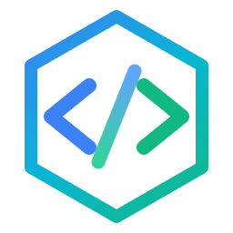

# DevDrill — Offline LeetCode & Coding Interview Practice

Practice curated coding interview tracks completely offline with Python and JavaScript. Built for desktop speed, distraction-free focus, and zero internet dependency.



## Highlights

- **100% Offline**: In-browser/desktop Python execution via Pyodide (WebAssembly) and JavaScript via isolated Web Workers — no server or internet connection required.
- **Curated Problem Tracks**:
  - **NeetCode 150** (150 problems covering core patterns)
  - **Blind 75** (75 classic LeetCode essentials)
  - **Beginner 30** (30 foundational problems for starting out)
- **Native Desktop Experience**:
  - Dedicated multi-page navigation: Problem Library (`Ctrl+1`), Code Studio (`Ctrl+2`), Performance Analytics (`Ctrl+3`), Settings (`Ctrl+,`)
  - Frameless desktop chrome with native window controls (minimize, maximize, close)
  - Edge-to-edge layout optimized for desktop viewports
- **Monaco Code Editor**:
  - Full VS Code editor engine with customizable themes, font size, tab spacing, and JetBrains Mono typography
  - Integrated split panels: Problem description, code editor, test runner, and console output
- **Progress Tracking & Analytics**:
  - 52-week activity heatmap with streak calculations
  - Difficulty distribution (Easy, Medium, Hard) and topic completion breakdown
  - IndexedDB local storage with export/import backup capabilities
- **Over-The-Air Desktop Updater**:
  - Integrated update checker pulling releases directly from GitHub

---

## Quick Start (Web Development)

```bash
git clone https://github.com/bilalshemsu1/dev-drill.git
cd dev-drill
npm install
npm run dev
```

## Production Build

```bash
npm run build
```

## Desktop Build (Neutralino.js)

```bash
# Build web bundle and launch desktop window
npm run desktop:run

# Build standalone desktop release
npm run desktop:build
```

---

## Tech Stack

- **Frontend**: React 19, React Router 7, Vite 7, Lucide Icons
- **Editor**: Monaco Editor (`@monaco-editor/react`)
- **Code Execution**: Pyodide (Python WASM) & Web Workers (JavaScript)
- **Desktop Engine**: Neutralino.js (lightweight portable native desktop runtime)
- **Storage**: IndexedDB (`idb`) & LocalStorage
